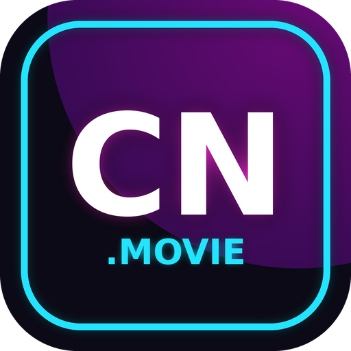

# CN.MOVIE 🎬

تطبيق أندرويد بثيم نيون لتصفّح سينمانا.

**تطوير: مهند سات لنك**

## المميزات
- شاشة بداية نيون مع الشعار واسم المطور
- شريط علوي نيون فيه أزرار الرئيسية والتحديث وحول التطبيق
- تسجيل الدخول يبقى محفوظاً بعد إغلاق التطبيق
- تشغيل الفيديو بملء الشاشة وبالوضع الأفقي
- التحميلات تنحفظ في مجلد `Download/CN.MOVIE`
- شاشة تظهر عند انقطاع الإنترنت مع زر إعادة المحاولة
- الروابط الخارجية تفتح بالمتصفح
- شريط سفلي نيون: الرئيسية، الأقسام، بحث، الحساب
- مشغّل احترافي بملء الشاشة: سحب يسار للسطوع، يمين للصوت، أفقي للتقديم، نقرتين ±10 ثواني، قرص للتكبير وحذف الإطارات السوداء، قفل الشاشة
- تسجيل الدخول بـ Google و Facebook داخل التطبيق
- تحميل الفيلم بالجودات المتوفرة، والترجمة بصيغ SRT و VTT و ASS (مع تحويل الترميز العربي القديم)
- شاشة بداية وحدة سريعة
- تخطي صفحة «حمّل تطبيق سينمانا» تلقائياً

## بناء ملف APK بدون كمبيوتر (GitHub Actions)
1. ارفع كل الملفات على مستودع جديد في GitHub (الفرع `main`).
2. افتح تبويب **Actions**، وتلقى البناء **Build CN.MOVIE APK** يشتغل تلقائياً.
3. بعد ما يخلص (تقريباً 3-5 دقائق) افتح البناء ونزّل **CN.MOVIE-apk** من قسم **Artifacts**.
4. فك الضغط عن الملف وثبّت `CN.MOVIE.apk` على الجهاز.

## البناء بـ Android Studio
افتح المجلد في Android Studio، ثم من القائمة: Build ← Build APK(s).

## ملاحظة
قبل النشر على متجر Google Play، بدّل مفتاح التوقيع بمفتاحك الخاص.
